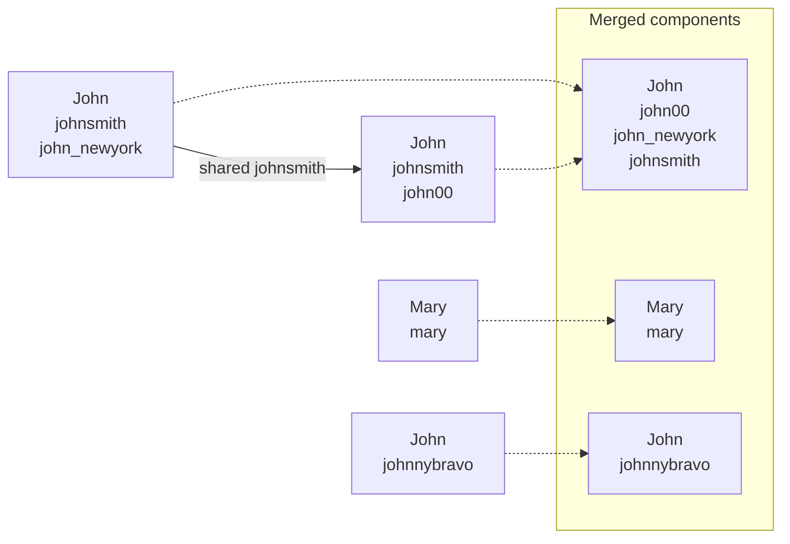

# Accounts Merge (LeetCode 721, Medium)

LeetCode: <https://leetcode.com/problems/accounts-merge/>

## Problem Description

Given a list of accounts where the first element is a name and the remaining elements are email
addresses, merge accounts that belong to the same person.

Two accounts belong to the same person if they share at least one email address. Return merged
accounts with the name first and the email addresses sorted.

## Examples

```text
Input: accounts = [["John","johnsmith@mail.com","john_newyork@mail.com"],
                   ["John","johnsmith@mail.com","john00@mail.com"],
                   ["Mary","mary@mail.com"],
                   ["John","johnnybravo@mail.com"]]
Output: [["John","john00@mail.com","john_newyork@mail.com","johnsmith@mail.com"],
         ["Mary","mary@mail.com"],
         ["John","johnnybravo@mail.com"]]
```

```text
Input: accounts = [["Gabe","Gabe0@m.co","Gabe3@m.co","Gabe1@m.co"],
                   ["Kevin","Kevin3@m.co","Kevin5@m.co","Kevin0@m.co"],
                   ["Ethan","Ethan5@m.co","Ethan4@m.co","Ethan0@m.co"],
                   ["Hanzo","Hanzo3@m.co","Hanzo1@m.co","Hanzo0@m.co"],
                   ["Fern","Fern5@m.co","Fern1@m.co","Fern0@m.co"]]
Output: [["Ethan","Ethan0@m.co","Ethan4@m.co","Ethan5@m.co"],
         ["Gabe","Gabe0@m.co","Gabe1@m.co","Gabe3@m.co"],
         ["Hanzo","Hanzo0@m.co","Hanzo1@m.co","Hanzo3@m.co"],
         ["Kevin","Kevin0@m.co","Kevin3@m.co","Kevin5@m.co"],
         ["Fern","Fern0@m.co","Fern1@m.co","Fern5@m.co"]]
```

## Illustration



**Topics**: Union-Find, Graph

## Build / Test (Bazel)

- Build: `bazel build //accounts-merge/...`
- Test: `bazel test //accounts-merge/tests:tests-accounts-merge`
