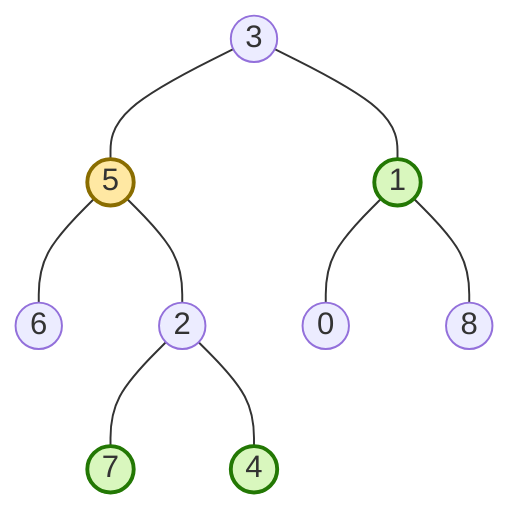

# All Nodes Distance K in Binary Tree (LeetCode 863, Medium)

LeetCode: <https://leetcode.com/problems/all-nodes-distance-k-in-binary-tree/>

## Problem Description

Given the root of a binary tree, a target node, and an integer `k`, return the values of all nodes
whose distance from the target is exactly `k`.

The answer may be returned in any order.

## Examples

```text
Input: root = [3,5,1,6,2,0,8,null,null,7,4], target = 5, k = 2
Output: [7,4,1]
```

```text
Input: root = [1], target = 1, k = 3
Output: []
```

## Illustration



**Topics**: Tree, Graph BFS

## Build / Test (Bazel)

- Build: `bazel build //all-nodes-distance-k/...`
- Test: `bazel test //all-nodes-distance-k/tests:tests-all-nodes-distance-k`
