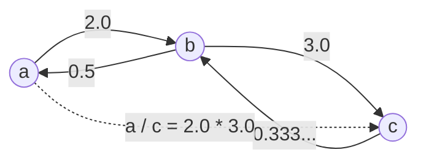

# Evaluate Division (LeetCode 399, Medium)

LeetCode: <https://leetcode.com/problems/evaluate-division/>

## Problem Description

Given equations such as `a / b = value`, answer division queries such as `x / y`.

If a query cannot be determined from the known equations, return `-1.0` for that query.

## Examples

```text
Input: equations = [["a","b"],["b","c"]], values = [2.0,3.0],
       queries = [["a","c"],["b","a"],["a","e"],["a","a"],["x","x"]]
Output: [6.00000,0.50000,-1.00000,1.00000,-1.00000]
```

```text
Input: equations = [["a","b"],["b","c"],["bc","cd"]], values = [1.5,2.5,5.0],
       queries = [["a","c"],["c","b"],["bc","cd"],["cd","bc"]]
Output: [3.75000,0.40000,5.00000,0.20000]
```

## Illustration



**Topics**: Graph, Union-Find, BFS/DFS

## Build / Test (Bazel)

- Build: `bazel build //evaluate-division/...`
- Test: `bazel test //evaluate-division/tests:tests-evaluate-division`
