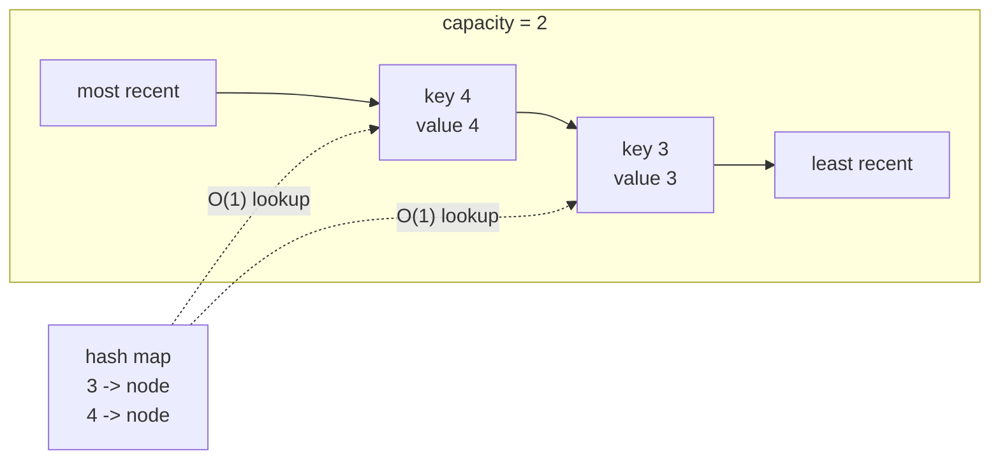

# LRU Cache (LeetCode 146, Medium)

LeetCode: <https://leetcode.com/problems/lru-cache/>

## Problem Description

Design a least recently used cache with a positive capacity.

The cache should support the following operations in `O(1)` average time:

- `get(key)`: Return the value for `key` if it exists, otherwise report a miss.
- `put(key, value)`: Sets or inserts the value if the key is not already present. When the cache
  reaches its capacity, evict the least recently used item before inserting a new item.

## Requirements

- The constructor should accept the cache’s capacity.
- Use appropriate STL containers.
- Thread safety is not required, but code clarity matters.
- This implementation reports a cache miss by throwing `std::out_of_range`.

## Examples

```text
Input:
["LRUCache","put","put","get","put","get","put","get","get","get"]
[[2],[1,1],[2,2],[1],[3,3],[2],[4,4],[1],[3],[4]]
Output:
[null,null,null,1,null,-1,null,-1,3,4]
```

## Illustration



## Build / Test (Bazel)

- Build: `bazel build //lru_cache/...`
- Test: `bazel test //lru_cache/tests:tests-lru_cache`
