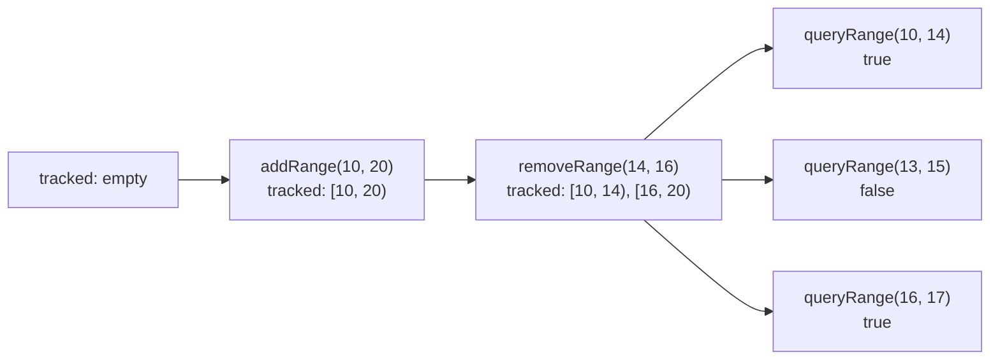

# Range Module (LeetCode 715, Hard)

LeetCode: <https://leetcode.com/problems/range-module/>

## Problem Description

Design a data structure that tracks half-open integer ranges of the form `[left, right)`.

It should support adding ranges, removing ranges, and querying whether every number in a requested
range is currently tracked.

## Examples

```text
Input:
["RangeModule","addRange","removeRange","queryRange","queryRange","queryRange"]
[[],[10,20],[14,16],[10,14],[13,15],[16,17]]
Output:
[null,null,null,true,false,true]
```

## Illustration



## API

```cpp
class Ranges {
public:
  void add_range(int left, int right);
  void remove_range(int left, int right);
  bool query_range(int left, int right);
};
```

## Build / Test (Bazel)

- Build: `bazel build //ranges/...`
- Test: `bazel test //ranges/tests:tests-ranges`
