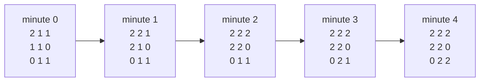

# Rotting Oranges (LeetCode 994, Medium)

LeetCode: <https://leetcode.com/problems/rotting-oranges/>

## Problem Description

Given a grid where each cell may be empty, contain a fresh orange, or contain a rotten orange:

- `0` = empty cell
- `1` = fresh orange
- `2` = rotten orange

Every minute, any fresh orange that is 4-directionally adjacent to a rotten orange becomes rotten.

Return the minimum number of minutes until no fresh orange remains. If this is impossible, return
`-1`.

## Examples

```text
Input: grid = [[2,1,1],[1,1,0],[0,1,1]]
Output: 4
```

```text
Input: grid = [[2,1,1],[0,1,1],[1,0,1]]
Output: -1
Explanation: The fresh orange in the bottom-left corner can never rot.
```

```text
Input: grid = [[0,2]]
Output: 0
```

## Illustration



## Approach (BFS)

Use **multi-source BFS**:

- Push all initially-rotten cells into a queue.
- BFS level-by-level (each level = 1 minute).
- Track how many fresh oranges remain; if any are left at the end, return `-1`.

## Build / Test (Bazel)

- Build: `bazel build //rotting-oranges/...`
- Run only this module’s tests: `bazel test //rotting-oranges/tests:tests-rotting_oranges`
