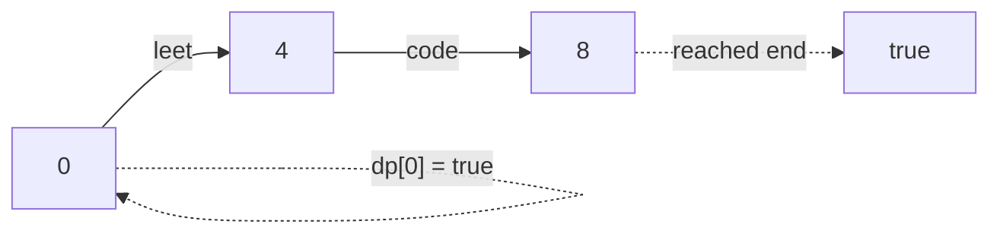

# Word Break (LeetCode 139, Medium)

LeetCode: <https://leetcode.com/problems/word-break/>

## Problem Description

Given a string `s` and a dictionary `wordDict`, return whether `s` can be segmented into a sequence
of one or more dictionary words.

Dictionary words may be reused multiple times.

## Examples

```text
Input: s = "leetcode", wordDict = ["leet","code"]
Output: true
Explanation: "leetcode" can be segmented as "leet code".
```

```text
Input: s = "applepenapple", wordDict = ["apple","pen"]
Output: true
Explanation: "applepenapple" can be segmented as "apple pen apple".
```

```text
Input: s = "catsandog", wordDict = ["cats","dog","sand","and","cat"]
Output: false
```

## Illustration



**Topics**: DP, Trie (optional)

## Build / Test (Bazel)

- Build: `bazel build //word-break/...`
- Test: `bazel test //word-break/tests:tests-word-break`
